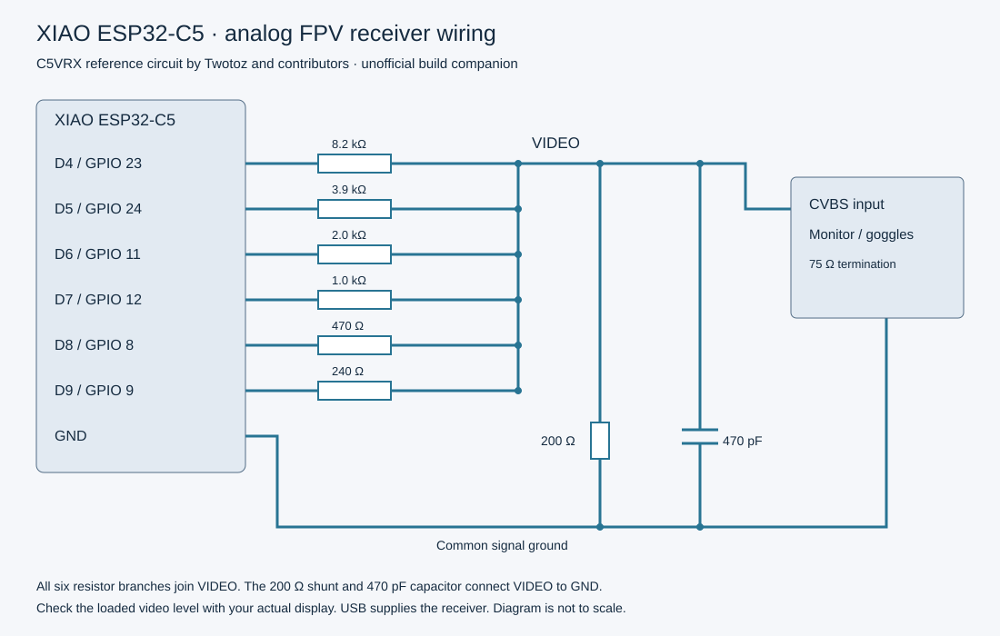

# ESP32 FPV Receiver

Build a 5.8 GHz analog FPV receiver with a **Seeed Studio XIAO ESP32-C5**, a
resistor DAC and **C5VRX firmware**. The decoded picture goes to a composite
video monitor or goggles. An optional browser console provides USB controls.

**[Open the USB console](https://codingard.github.io/esp32-fpv-receiver/)** ·
**[Wiring diagram](docs/wiring.svg)** · **[Build guide](docs/BUILD.md)**

This companion adapts the wiring and receiver instructions from
**[C5VRX by Twotoz and the C5VRX contributors](https://github.com/Twotoz/C5VRX)**.
The firmware source is included as a pinned Git submodule, without modifications.
Visit the **[official C5VRX website](https://twotoz.github.io/C5VRX/)** for the
original project, web flasher and Discord invite. This is an unofficial build
companion, not an official C5VRX release or an independently invented receiver.
[Source provenance and licenses](docs/ATTRIBUTION.md).



## What you need

| Part | Quantity | Notes |
| --- | --- | --- |
| Seeed Studio XIAO ESP32-C5 | 1 | Exact reference board; other ESP32 variants are not interchangeable |
| USB data cable | 1 | Power, firmware installation and optional console |
| Antenna | 1 | Suitable for the board and 5.8 GHz, attached as specified by the board vendor |
| 8.2 kΩ, 3.9 kΩ, 2.0 kΩ, 1.0 kΩ, 470 Ω, 240 Ω resistors | 1 each | Six DAC branches; 1% parts are a reasonable assembly choice |
| 200 Ω resistor | 1 | Reference shunt from VIDEO to GND |
| 470 pF ceramic capacitor | 1 | Reference filter from VIDEO to GND |
| Composite video connector, short wires and soldered prototype board | As needed | Common signal ground; short DAC wiring |
| CVBS monitor or FPV goggles with analog video input | 1 | 75 Ω input; not an HDMI-only display |
| Compatible analog 5.8 GHz FPV camera/transmitter | 1 | Your own test source, with its antenna and specified power supply |

[Machine-readable parts list](docs/bom.csv). This receives **analog** FPV video;
it does not decode proprietary digital FPV systems.

## Build and connect

1. Assemble the six resistor branches exactly as shown in the diagram. Each
   branch joins the same VIDEO node. Add the shunt and filter to ground, then
   connect VIDEO and GND to the display's composite input. [Full pin table](docs/BUILD.md).
2. Power the receiver through its normal USB input. Power the camera/transmitter
   according to its own specification; do not power it from the XIAO's 3.3 V pin.
3. Install C5VRX using its [official web flasher](https://twotoz.github.io/C5VRX/).
   Flashing replaces the program on the board. Record the release installed.
4. Close the flasher so it releases USB. Select the matching channel using the
   board's BOOT button or the optional [USB console](https://codingard.github.io/esp32-fpv-receiver/).
5. View the picture on the analog monitor or goggles. The browser console shows
   serial messages; it does not receive video over the XIAO's USB port.

The reference network includes a 200 Ω shunt. The connected display may add its
own 75 Ω termination. Check the loaded VIDEO level and sync with your actual
display; do not add another 75 Ω resistor blindly.

## Get all source code

```sh
git clone --recurse-submodules https://github.com/codingard/esp32-fpv-receiver.git
cd esp32-fpv-receiver
```

If you already cloned without submodules:

```sh
git submodule update --init --recursive
```

The firmware is in `firmware/C5VRX/`, pinned to
`b8d32b90f479feff7fbb34e6ca01cc9ba2d0d697`. It retains its upstream license,
notices and history. The upstream web flasher can install a newer release;
use [the source build instructions](docs/BUILD.md#build-the-pinned-firmware) when
you need this exact revision.

## Browser console

Use desktop Chrome or Edge on HTTPS or localhost. The console opens USB at
115200 baud and offers the documented diagnostics, next-channel and manual-gain
commands. It displays only text received from the device. Selecting a serial
port does not itself prove it is a C5VRX receiver; check the firmware output.

Run locally with Python 3:

```sh
python3 -m http.server 4174 --bind 127.0.0.1 --directory web
```

Open <http://127.0.0.1:4174>. No packages or backend are required. There is no
simulated data, noise generator, video playback, analytics or upload service.
Logs stay in your browser until you explicitly download them. Close other serial
monitors before connecting. Changing channel or gain can interrupt the picture;
perform setup on the bench.

## How the receiver works

C5VRX acquires raw I/Q through the ESP32-C5 RF diagnostic path at 40 MS/s,
uses BitScrambler for wideband FM demodulation, and drives the six-bit resistor
DAC through PARLIO. The DAC produces analog composite video. A background CPU
task manages settings while dedicated peripherals carry the continuous pixel
path. These mechanisms and the hardware design come from C5VRX.

## Validation status

**This companion has not been bench-tested with a physical receiver.** The
upstream project documents its own hardware results and remaining limitations;
those are not tests of this companion. The browser transport has automated
checks, and the published guide is checked against the pinned upstream pinout.
No claim is made about range, latency, RF sensitivity or reliable flight use.

The social spectrum animation was a synthetic illustration. It is not a recording
of decoded FPV video and is not included as measurement evidence here. The actual
receiver output is the analog picture on your attached monitor.

Run `npm test` with Node.js 20+ for the console transport and wiring checks.
See [physical acceptance steps](docs/TESTING.md) before marking a build tested.

## Troubleshooting

- **No USB port:** check the data cable, desktop browser and USB access. Close
  the flasher and serial monitors before opening the console.
- **Connected but no logs:** click Diagnostics. Confirm the correct port, C5VRX
  firmware and 115200 baud. A USB connection is not an RF-lock indication.
- **No picture:** check the analog input, common ground, matching transmitter
  channel, antenna and all six DAC branches. Verify VIDEO level under load.
- **Noise, grain or unstable sync:** consult the upstream diagnostics and current
  known limits. Do not assume a different resistor value or gain setting is a
  validated fix for every receiver.
- **Need video in a browser:** use a separate compatible analog-to-USB video
  capture device; this console does not implement that additional path.

## Credits and license

C5VRX by Twotoz and the C5VRX contributors is licensed under **GPL-3.0-only**.
This companion's original console, diagram and adapted documentation are also
released under GPL-3.0-only. Upstream notices remain in the firmware submodule.
C5VRX branding has separate terms; no upstream logo is reused here. Espressif,
Seeed Studio and other third-party names belong to their respective owners.
